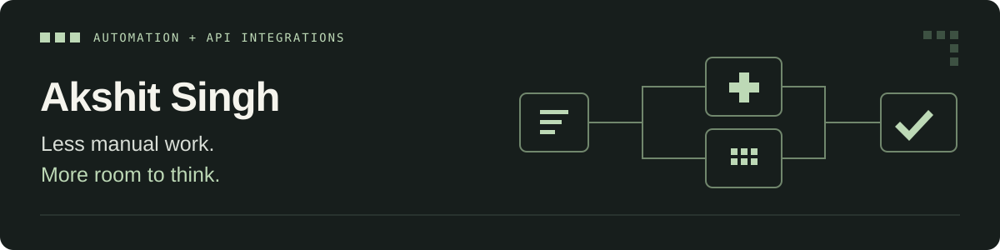

  

I build automation tools that help teams organise requests, follow up with customers and keep work moving. My portfolio combines **Python, n8n, REST APIs and PostgreSQL**, with AI where it is useful and explicit checks around the workflow.

[Explore my portfolio](https://akshit-portfolio-jlzx.onrender.com/) · [LinkedIn](https://www.linkedin.com/in/akshit-singh-outlook/) · [Contact](mailto:akshit.s22@outlook.com)

### Start here

**[Service Operations Control Tower](https://github.com/Axhitgg/service-operations-control-tower)**  
An EV service-workflow prototype with AI classification, enforced human-review gates, technician and parts checks, appointment proposals and approval audit events. Includes automated regression and PostgreSQL integration checks, an importable n8n workflow and a documented case study.

[View the illustrative walkthrough](https://akshit-portfolio-jlzx.onrender.com/#flagship) · [Read the case study](https://github.com/Axhitgg/service-operations-control-tower/blob/main/docs/CASE_STUDY.md)

### More projects

| Project | What it explores |
| --- | --- |
| [Customer Support Ticket System](https://github.com/Axhitgg/customer-support-ticket-system) | Classifying support requests, storing structured records and routing email notifications. |
| [Invoice Payment Automation](https://github.com/Axhitgg/invoice-payment-automation) | Tracking reminder attempts, preventing overlapping runs and suppressing reminders after payment, with dry-run previews and failure recovery. |
| [Lead Follow-up System](https://github.com/Axhitgg/lead-followup-system) | Flagging urgent enquiries, normalising email addresses and checking repeat lead IDs. |
| [Portfolio source](https://github.com/Axhitgg/akshit-portfolio) | An HTML, CSS and JavaScript portfolio with interactive, illustrative workflow scenarios. |

### Tools I work with

**Backend:** Python, Flask, REST APIs, JSON, SQL, PostgreSQL  
**Automation and AI:** n8n, webhooks, OpenAI API, Anthropic API  
**Testing and delivery:** Pytest, Git, GitHub Actions, Docker, Docker Compose, Render

### What I am working on

- Practising the flagship workflow's approval, transaction and failure-handling decisions.
- Reviewing results on labelled synthetic cases before making accuracy claims.
- Learning JavaScript and CRM integration through a guided HubSpot project.

### A little context

My background is in legal practice, including research, drafting and case preparation. I am bringing that attention to detail into automation while developing my engineering skills through hands-on projects.

Outside this work, I enjoy typography, pixel art and thoughtful digital experiences.

**Open to paid, full-time automation and API-integration opportunities. Based in India; remote-first.**

These are portfolio projects, not claims of client deployments or measured business savings. The walkthrough is illustrative; individual repositories document implementation boundaries.
